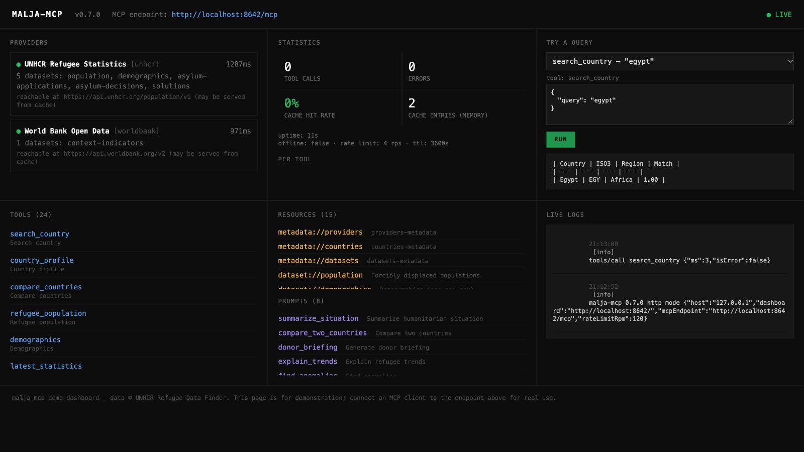
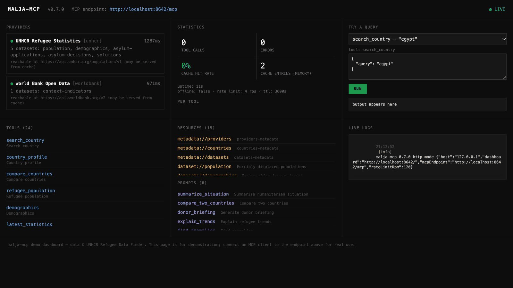
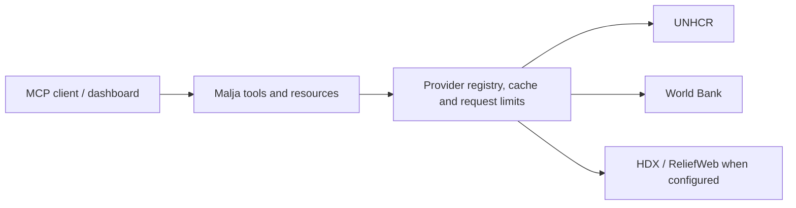

# Malja MCP — ملجأ

**بيانات إنسانية بمصادرها، داخل أدوات البحث ومساعدك الذكي.**

Read-only access to humanitarian data through the Model Context Protocol, with Arabic and English output, source attribution and reproducible exports.

[](https://github.com/marsaplatform/malja-mcp/actions/workflows/ci.yml)
[](LICENSE)



## جرّبه فعليًا · See it work



Captured from the local application on 24 October 2026. The GIF shows `search_country` resolving Egypt to `EGY`. Provider status, latency, counters and available resources reflect this capture and configuration; they are not service guarantees or current humanitarian statistics.

## What it does

- Resolve country names in Arabic and English to ISO3 codes.
- Query displacement, demographics, asylum and durable solutions data from UNHCR.
- Add population and economic context from World Bank indicators.
- Enable HDX crisis datasets and ReliefWeb reports with their required provider configuration.
- Compare countries, inspect trends, generate charts and export data or reports with citations.
- Connect over stdio or Streamable HTTP; inspect tools and run queries in the built-in dashboard.

ملجأ يربط بيانات المفوضية والبنك الدولي، ومع الإعداد المناسب HDX وReliefWeb، بأدوات بحث للقراءة فقط. يدعم أسماء الدول والإجابات بالعربية، ويرفق مصادر البيانات بالتقارير والتصدير. التغطية وتاريخ البيانات يعتمدان على المصدر والإعداد.

## Run locally

The following source workflow was verified with Node.js 24. Use this checkout for the current implementation; published packages, images and release tags may lag behind the source.

```bash
git clone https://github.com/marsaplatform/malja-mcp.git
cd malja-mcp
npm ci
npm run build
node dist/index.js --http
```

Open **http://127.0.0.1:8642/** for the dashboard. The local MCP endpoint is **http://127.0.0.1:8642/mcp**. Select `search_country`, enter `{"query":"egypt"}`, then select **RUN**.

For stdio, use `node dist/index.js` without `--http`. For Docker, build the checked-in configuration with `docker compose up -d --build`; see [compose.yaml](compose.yaml) and [.env.example](.env.example).

This README documents self-hosting. It does not assume an available public hosted endpoint. HTTP access has no built-in authentication; configure access controls before exposing it. See [SECURITY.md](SECURITY.md).

### Connect your client (self-hosted, stdio)

<details><summary><strong>Claude Desktop</strong> — <code>claude_desktop_config.json</code></summary>

```json
{
  "mcpServers": {
    "malja": {
      "command": "node",
      "args": ["/absolute/path/to/malja-mcp/dist/index.js"]
    }
  }
}
```

Sample with cache tuning: [examples/claude-desktop-config.json](examples/claude-desktop-config.json).

</details>

<details><summary><strong>Claude Code</strong></summary>

```bash
claude mcp add malja -- node /absolute/path/to/malja-mcp/dist/index.js
```

</details>

<details><summary><strong>Cursor</strong> — <code>.cursor/mcp.json</code> (project) or <code>~/.cursor/mcp.json</code> (global)</summary>

```json
{
  "mcpServers": {
    "malja": {
      "command": "node",
      "args": ["/absolute/path/to/malja-mcp/dist/index.js"]
    }
  }
}
```

</details>

<details><summary><strong>VS Code</strong> — <code>.vscode/mcp.json</code></summary>

```json
{
  "servers": {
    "malja": {
      "type": "stdio",
      "command": "node",
      "args": ["/absolute/path/to/malja-mcp/dist/index.js"]
    }
  }
}
```

</details>

<details><summary><strong>Windsurf</strong> — <code>~/.codeium/windsurf/mcp_config.json</code></summary>

```json
{
  "mcpServers": {
    "malja": {
      "command": "node",
      "args": ["/absolute/path/to/malja-mcp/dist/index.js"]
    }
  }
}
```

</details>

Then ask: _"What are the top refugee-hosting countries this year?"_

## Configuration and data boundaries

UNHCR and World Bank are enabled by default. HDX needs an app identifier; ReliefWeb needs an approved appname. Provider credentials and environment settings are documented in [.env.example](.env.example).

- Use `locale: "ar"` per tool call or `MALJA_LOCALE=ar` for Arabic output.
- Offline mode needs a previously warmed cache; missing cached requests fail explicitly.
- Data freshness follows the original publisher and cache settings. On upstream failure, cached results can be stale.
- Distinguish stocks from flows, and check category, reference year and extraction date before comparing figures.
- Forecasts are labelled extrapolations, not operational planning estimates.

## Architecture



## Development

```bash
npm run check          # types, lint, formatting and tests
npm run build          # production output
npm audit              # dependency advisories at the time of the check
```

Validation records are dated rather than embedded as permanent marketing counts: [24 October 2026 review](docs/CODE_REVIEW_2026-10-24.md). The CI badge links to actual workflow results.

## Documentation

- [Tool reference](docs/tools.md) · [architecture](docs/architecture.md)
- [Research methods](docs/for-researchers.md) · [MCP introduction](docs/how-mcp-works.md)
- [Client and notebook examples](examples/) · [provider development](docs/adding-providers.md)
- [Contributing](CONTRIBUTING.md) · [security reporting](SECURITY.md)
- [Citation metadata](CITATION.cff) · [license](LICENSE)

## Attribution

Independent project; not an official UN or World Bank product. Data retains its original publishers' attribution and terms. Cite both the software and the original datasets; preserve the extraction manifest when sharing results. The source code is [MIT licensed](LICENSE).

## Company container image

The maintained container is published under the company account and linked to
[`marsaplatform/malja-mcp`](https://github.com/marsaplatform/malja-mcp).

```sh
docker pull ghcr.io/marsaplatform/malja-mcp:latest
```

Use the **Publish company container** workflow to publish the current source.
`latest` tracks the latest manual publication; immutable `sha-…` tags identify
the source commit. Historical packages in the old personal namespace are not
the maintained installation target. Publishing does not change repository visibility.

### Versioned updates

See [container releases and migration](docs/container-releases.md) for numbered
versions, automatic release publishing, runtime verification, and the updated
company installation commands.
